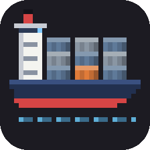

<p align="center"></p>

# Fleet

The family's terminal apps in one terminal: [Splice](../splice) (git), [Trawl](../trawl) (SQL),
[Sonar](../sonar) (Azure), [Bosun](../bosun) (a project's processes), [Hail](../hail) (HTTP) and
[Keel](../keel)'s terminal app (Azure DevOps) and [Wharf](../wharf) (containers). Each runs exactly as it does by itself, with its own
settings, sign-ins and keys; Fleet shows one at a time and switches between them with `ctrl+]`, as
tmux does with its windows. A bar at the bottom shows them all.

```
 1 Splice ●  2 Trawl ●  3 Sonar ○  4 Bosun ○  5 Hail ✕1  6 Keel ○  7 Wharf ○      ctrl+] ? help
```

`●` runs, `○` hasn't started yet, `✕` and a number exited with that code. The app on screen has its
tab in its own colour.

A tab off screen gets a badge when its app needs you: `!` when it has become worried or sad since you
last looked at it (Bosun's process crashed or gave up, Hail's checks failed, Wharf's container exited
with an error, Sonar ran into trouble), and a count of the alerts it logged since (Sonar's watches going
over their threshold, Bosun's crashes). The bar says why for a moment and the terminal's bell rings once
as a badge appears; looking at the space clears it. Fleet reads what the apps tell each other (their
moods and the family's activity log, in `~/.family` or `FAMILY_HOME`) every few seconds, so an app
whose moods are turned off in its settings never gets a `!`.

```
 1 Splice ●  2 Trawl ●  3 Sonar ● 2  4 Bosun ● !  5 Hail ○  6 Keel ○  7 Wharf ○   Bosun: api crashed
```

## Install

**On Windows**, download `fleet-windows-x64-setup.exe` from the [latest release](https://github.com/FranciscoNunes-dxspark/fleet/releases?q=fleet-v&expanded=true)
and run it. It installs Fleet for you (no administrator needed), with a Windows Terminal of its own to
open in, and adds **Fleet** to the Start menu. It asks which folder Fleet should open in: the one that
holds your repositories and projects. That terminal has a font with every character the apps draw
(Maple Mono NF CN when you have it installed, else Cascadia Mono), and ctrl+c and ctrl+v copy and paste. Run
the setup again to pick another folder; your changes to the terminal's settings
(`%LOCALAPPDATA%\Programs\Fleet\terminal\settings\settings.json`) are kept.

Started some other way on Windows, as the bare `fleet-windows-x64.exe` opens in Windows' own console,
whose one font lacks many of the apps' characters: Fleet draws lookalikes in their place there.

**Elsewhere**, or for the bare executable, download `fleet` for your platform from the [latest release](https://github.com/FranciscoNunes-dxspark/fleet/releases?q=fleet-v&expanded=true)
and put it on your PATH. It is one executable with all seven apps inside, so it's the only download you
need. It checks for a new version once a day and installs it by itself; the new version starts the
next time you open Fleet. (The apps inside don't update themselves: Fleet updates them together. `/update` in any of them asks Fleet to look for a new version now and install it.)

From a checkout of the [fleet repository](https://github.com/FranciscoNunes-dxspark/fleet) (Node 22 or later):

```bash
npm install                  # at the repository's root
cd apps/fleet
npm start                    # or: node bin/fleet.js splice
```

From a checkout, Fleet runs each app from its own folder in the checkout.

## Use

```bash
fleet               # opens the app you used last (Splice the first time)
fleet trawl         # opens Trawl
fleet keel --demo   # opens Keel, started with --demo
fleet hail api.http # anything after the app's name is that app's own arguments
```

An app starts the first time you switch to it, in the folder you started Fleet in, and keeps running
when you switch away. Quitting one (its own `q`) leaves its space saying so: `↵` starts
it again.

## Keys

Everything you type goes to the app on screen, as it would by itself: keys, pastes and the mouse.
Only `ctrl+]` is Fleet's, and the key after it:

| Keys | What they do |
| --- | --- |
| `alt+1`–`alt+7` | Switch to that space (no prefix; terminals don't send `ctrl+alt` with a digit) |
| `ctrl+]` `1`–`6` | Switch to that space |
| `ctrl+]` `s` `t` `o` `b` `h` `k` `w` | Switch to Splice, Trawl, Sonar (o), Bosun, Hail, Keel, Wharf |
| `ctrl+]` `]` or `n` | The next space |
| `ctrl+]` `p` | The previous space |
| `ctrl+]` `ctrl+]` | Send `ctrl+]` to the app |
| `ctrl+]` `q` | Quit Fleet, stopping every app (it asks first when any is running) |
| `ctrl+]` `?` | The keys |

Any other key after `ctrl+]` cancels it. A click on a tab in the bar switches to it, whatever the app on screen does with the mouse: Fleet keeps clicks on for the bar, even for an app with its mouse turned off or one that has exited, and passes clicks on only to an app that wants them. With an app's mouse off, select text the terminal's own way while Fleet runs: most terminals select with shift held down.

## Hand-offs

The apps hand each other things as a line to paste into the other's prompt: Sonar's `T` copies a
`/azure-sql …` line for Trawl, Splice's `Y` a `/take …` for Sonar, and so on. Inside Fleet that's one
step: Fleet switches to the app the line is for (starting it if it isn't running), and types the line
into its prompt. Press `↵` to run it. The line is still copied too. A line that several apps could take
(a log line, which Sonar, Hail and Bosun all read) goes to the first of them that's running, else
stays on the clipboard only.

## Notes

- Fleet keeps the app it opened last in `~/.fleet/host.json` (`FLEET_HOME` moves the folder).
  `FLEET_NO_UPDATE_CHECK=1` turns the update check off. `FLEET_NO_BELL=1` (or `"bell": false` in
  `host.json`) keeps the bell quiet when a badge appears.
- Each app keeps its settings where it always does (`~/.splice`, `~/.trawl`, …), so they're the same
  inside Fleet and out.
- Colours follow your terminal's: 24-bit where it has them, else the nearest of 256.
