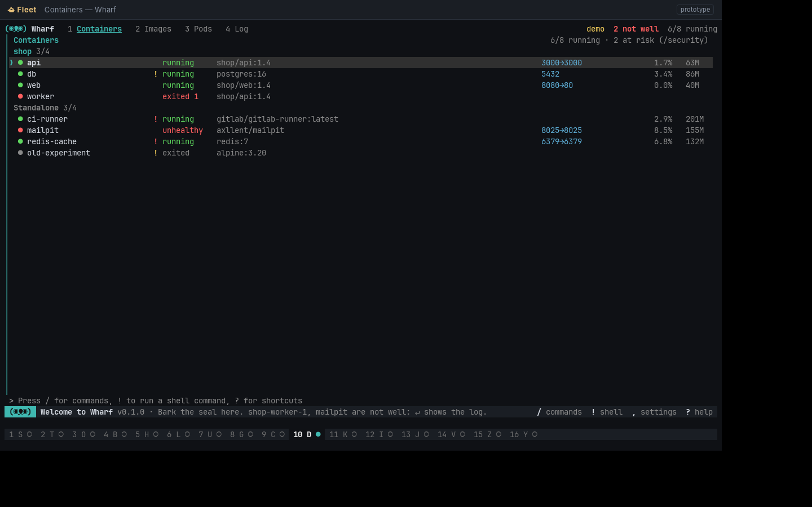
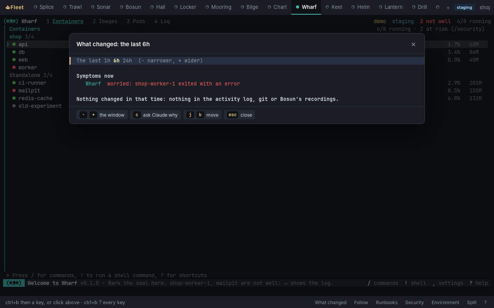

# Fleet desktop (prototype)

Fleet in a window of its own. The window is a [Tauri](https://tauri.app) app: a small Rust program with the system's web view. It runs the `fleet` host behind a real pseudo-terminal (ConPTY on Windows, a pty elsewhere) and draws it with [xterm.js](https://xtermjs.org), the terminal VS Code uses. The host and the apps are exactly the programs you run in any terminal. What the window adds is its own frame, icon, font and colours, without Windows Terminal or any other terminal in between.

Fleet's bar is the window's own: the host, started with `FLEET_DESKTOP=1`, doesn't draw it in the terminal (the apps get every row) and sends its state instead as a private escape sequence (`OSC 5380`, the host's `barState`). The window draws that state as:

- **Tabs along the top:** each app's colour as a dot, its badges, and the app on screen underlined.
- **Pills beside them:** the environment (the frame turns red for production), `● REC` while a runbook records, and Claude's proposals.
- **A strip along the bottom:** notices, the prefix's keys while it waits, the folder being asked for, and the quit question with Quit and Stay buttons.
- **Buttons in that strip:** for what works across apps. These are what changed, following a request, the runbooks, security, the environment, the split and the help.

A click types the prefix and its key into Fleet, so the window adds no new way in, and every key works as in a terminal.



Fleet's panels (the environment, what changed, the runbooks, Claude's proposals, security, the apps on the bar, a request followed) and its help are the window's own overlays too. The host sends each panel's content as part of that state (its rows, with the host's colours), and the window draws it with the selected row highlighted.

- **Mouse:** a click on a row moves the panel's cursor there, a double click opens it as `↵` would, and clicking outside the panel or on × closes it.
- **Keys:** each key in the panel's hint is a button.

Those clicks go back to the host as `OSC 5381`, typed into Fleet like keys and taken out before Fleet reads them.



Next: a command palette (ctrl+k) over every app's commands, and toasts.

## Running it

You need:

- **Rust**, through [rustup](https://rustup.rs).
- **Node 22+.**
- **The system web view:**
  - **Windows:** WebView2, which Windows 10 and 11 already have.
  - **macOS:** nothing to install.
  - **Linux:** WebKitGTK, for example `sudo apt install libwebkit2gtk-4.1-dev libgtk-3-dev librsvg2-dev`.

Then, from this folder:

```bash
npm run dev      # fetches xterm.js into ui/vendor, then cargo run
npm run build    # the same, then a release build in src-tauri/target/release/
npm run bundle   # the installers, with Fleet inside (below)
```

### Which Fleet it runs

The window looks for Fleet in this order:

1. `FLEET_COMMAND`, if it's set.
2. A `fleet` executable beside its own, which is how an installer would lay them out.
3. `fleet` on the PATH.

To run Fleet from this checkout, point `FLEET_COMMAND` at the host's entry point:

```bash
FLEET_COMMAND="node ../apps/fleet/bin/fleet.js" npm run dev          # macOS, Linux
$env:FLEET_COMMAND = "node ..\apps\fleet\bin\fleet.js"; npm run dev   # Windows PowerShell
```

Fleet starts in `FLEET_CWD`, or in your home folder when that isn't set. Inside, everything works as in a terminal: the prefix (`ctrl+b`), the apps, the mouse and the split view. When Fleet ends, the window offers to start it again. Closing the window ends Fleet and its apps.

### Installers

```bash
npm run bundle
```

This builds Fleet's own executable (`apps/fleet`'s Bun build, with every app inside), copies it to `src-tauri/binaries/` (`scripts/sidecar.mjs`), and runs the Tauri CLI with `src-tauri/tauri.bundle.json`. That file carries Fleet in each installer as a "sidecar", installed beside the window's program as `fleet`, which is where the window looks first. An installed window needs nothing else: no Node, no checkout, no `FLEET_COMMAND`.

The installers land in `src-tauri/target/release/bundle/`:

- **Linux:** `.deb`, `.rpm` and `.AppImage`.
- **Windows:** `.msi`, and an `.exe` setup.
- **macOS:** `.dmg`.

Each platform builds its own. The Desktop workflow (`.github/workflows/desktop.yml`) builds all three on GitHub's machines whenever `desktop/` changes, or by hand, and keeps them as the run's artifacts.

Nothing is signed yet. Windows SmartScreen and macOS Gatekeeper will warn before opening them: on a Mac, right-click and Open the first time. The window's program is named `fleet-desktop`, not `Fleet`, because on Windows `Fleet.exe` and the bundled `fleet.exe` would be the same file.

## How it fits together

- `src-tauri/src/main.rs`: the pseudo-terminal, through WezTerm's `portable-pty` crate. It handles four commands from the web view (`start`, `write`, `resize`, `stop`) and sends back two events: `pty-data` carries Fleet's output, base64-encoded so a UTF-8 character split across two reads comes through whole; `pty-exit` reports that Fleet has ended.
- `ui/`: the window's page. `app.js` connects xterm.js to those commands and events, draws the bar and the panels from the host's `OSC 5380` (xterm.js's `registerOscHandler`), the panels' colours turned from their SGR into CSS, and tells the host about clicks on a panel with `OSC 5381`. `style.css` uses the kit's shell-look colours (`packages/kit/look.js`). `vendor/` is filled by `scripts/vendor.mjs` and isn't committed.
- `src-tauri/tauri.conf.json`: the window, the content security policy and the bundle's icons (Fleet's ship, from `apps/fleet/assets`).

This folder sits outside `apps/` on purpose. CI tests and releases every folder in `apps/` with Bun, and a Tauri app is built with cargo. When the window becomes a product, it gets a workflow of its own: a cargo build per platform, the Tauri CLI's installers, and signing.
