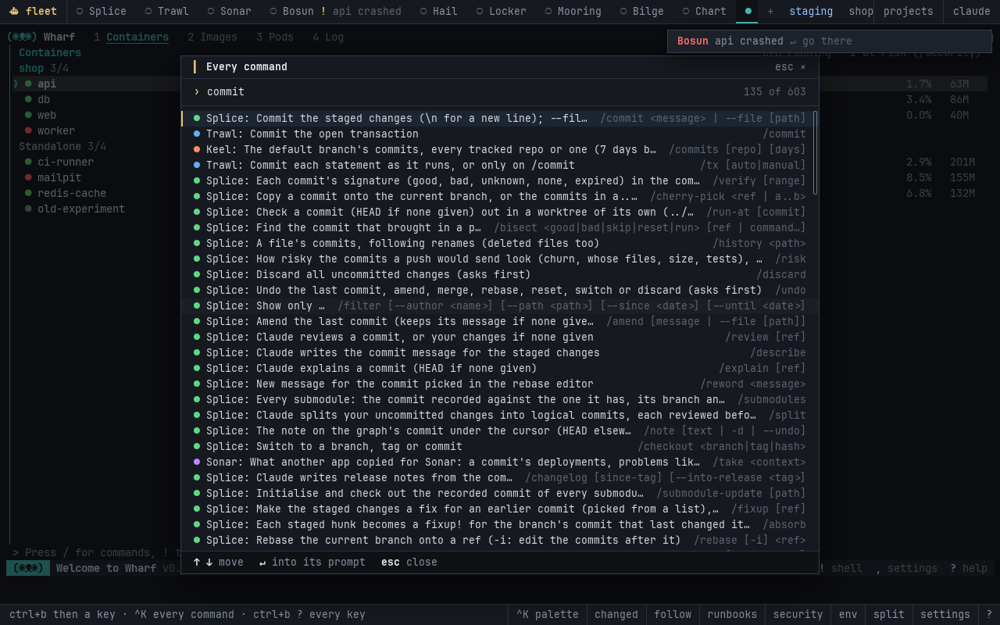

# Fleet desktop (prototype)

Fleet in a window of its own. The window is a [Tauri](https://tauri.app) app: a small Rust program with the system's web view. It runs the `fleet` host behind a real pseudo-terminal (ConPTY on Windows, a pty elsewhere) and draws it with [xterm.js](https://xtermjs.org), the terminal VS Code uses. The host and the apps are exactly the programs you run in any terminal. What the window adds is its own frame, icon, font and colours, without Windows Terminal or any other terminal in between.

The window is drawn to look like the terminal inside it: one monospace face, square corners, thin rules, and keys as bright characters with their words dim. Fleet's chrome is the window's own. The host, started with `FLEET_DESKTOP=1`, draws none of it in the terminal (the apps get every row). Instead it sends its state as a private escape sequence (`OSC 5380`, the host's `barState`), and the window draws:

- **Tabs along the top.** Each app's state mark in its colour (`●` running, `○` not started, `✕` exited) and its badge. A badge says why, in a few words, until you look ("Bosun ! api crashed"). The environment, `● REC` and Claude's proposals sit at the right, and the frame turns red for production.
- **Toasts.** When an app off screen needs you, a toast says so, and clicking it goes there. When the window is in the background, the system's own notification says it too (Settings turns that off).
- **A strip along the bottom.** It carries notices, the prefix's keys while they wait, the folder being asked for, and the quit question. Beside it are buttons for what works across the apps: the palette, what changed, following a request, the runbooks, security, the environment, the split, settings and the help.
- **Fleet's panels as overlays.** The environment, what changed, the runbooks, Claude's proposals, security, the apps on the bar, a request followed, and the help. A click on a row moves there, a double click opens it as `↵` would, and every key in a panel's hint is a button. Three panels draw a chart above their rows:
  - **What changed** is a timeline, a lane per app, with crashes and failures red.
  - **A request followed** is its path through the apps.
  - **Security** shows each app's findings by severity.
- **The palette (ctrl+k, or ctrl+shift+p).** Every app's slash commands (about 600, from each app's own table; `apps/fleet/src/commands.json`), Fleet's actions and Claude's proposals, with the app on screen first.
  - A command whose name starts with what you type comes first.
  - `↵` puts it in that app's prompt, switching to the app, for you to finish.
- **Projects**, at the right. The folders the fleet was in, and *Open folder…* (the system's dialog). Either moves the fleet there, after asking.
- **Claude**, at the right. Ask about a symptom ("checkout is slow since lunch"). Claude reads the timeline of what changed across the apps and answers there. Its proposals are a click away.
- **Settings.** The font size, the bell, notifications in the background, the prefix (from the next start) and the apps on the bar.

Links an app prints open in the browser, and images an app sends (sixel, iTerm's) are drawn. A click on a tab or a tool types the prefix and its key, as a person would. Everything else goes back to the host as `OSC 5381` messages, typed into Fleet like keys and taken out before Fleet reads them:

- a panel's row picked
- a palette line for an app
- a folder to move to
- a setting
- a question for Claude





## Running it

You need:

- **Rust**, through [rustup](https://rustup.rs).
- **Node 22+.**
- **The system web view:**
  - **Windows:** WebView2, which Windows 10 and 11 already have.
  - **macOS:** nothing to install.
  - **Linux:** WebKitGTK, for example `sudo apt install libwebkit2gtk-4.1-dev libgtk-3-dev librsvg2-dev`.

Then, from this folder:

```bash
npm run dev      # fetches xterm.js into ui/vendor, then cargo run
npm run build    # the same, then a release build in src-tauri/target/release/
npm run bundle   # the installers, with Fleet inside (below)
```

### Which Fleet it runs

The window looks for Fleet in this order:

1. `FLEET_COMMAND`, if it's set.
2. A `fleet` executable beside its own, which is how an installer would lay them out.
3. `fleet` on the PATH.

To run Fleet from this checkout, point `FLEET_COMMAND` at the host's entry point:

```bash
FLEET_COMMAND="node ../apps/fleet/bin/fleet.js" npm run dev          # macOS, Linux
$env:FLEET_COMMAND = "node ..\apps\fleet\bin\fleet.js"; npm run dev   # Windows PowerShell
```

Fleet starts in `FLEET_CWD`, or in your home folder when that isn't set. Inside, everything works as in a terminal: the prefix (`ctrl+b`), the apps, the mouse and the split view. When Fleet ends, the window offers to start it again. Closing the window ends Fleet and its apps.

### Installers

```bash
npm run bundle
```

This builds Fleet's own executable (`apps/fleet`'s Bun build, with every app inside), copies it to `src-tauri/binaries/` (`scripts/sidecar.mjs`), and runs the Tauri CLI with `src-tauri/tauri.bundle.json`. That file carries Fleet in each installer as a "sidecar", installed beside the window's program as `fleet`, which is where the window looks first. An installed window needs nothing else: no Node, no checkout, no `FLEET_COMMAND`.

The installers land in `src-tauri/target/release/bundle/`:

- **Linux:** `.deb`, `.rpm` and `.AppImage`.
- **Windows:** `.msi`, and an `.exe` setup.
- **macOS:** `.dmg`.

Each platform builds its own. The Desktop workflow (`.github/workflows/desktop.yml`) builds all three on GitHub's machines whenever `desktop/` changes, or by hand, and keeps them as the run's artifacts.

The installers aren't signed: Windows SmartScreen and macOS Gatekeeper warn before opening them the first time (on a Mac, right-click and Open). The window's program is named `fleet-desktop`, not `Fleet`, because on Windows `Fleet.exe` and the bundled `fleet.exe` would be the same file.

## How it fits together

- `src-tauri/src/main.rs`: the pseudo-terminal, through WezTerm's `portable-pty` crate. It handles four commands from the web view (`start`, `write`, `resize`, `stop`).
  - Fleet's output goes back as raw bytes through the channel `start` is given (an ArrayBuffer in the page, with no base64 or JSON in between). That's about 140 times less work per full-screen frame than base64 events, and a third less data. A UTF-8 character split across two reads is put back together by xterm.js.
  - The `pty-exit` event reports that Fleet has ended.
  - Three of Tauri's plugins: notifications, the open-folder dialog (and its questions), and the opener for links. `capabilities/default.json` allows the page just those.
- `ui/`: the window's page. `app.js` connects xterm.js to those commands and events, draws the bar, the panels (their colours turned from SGR into CSS, their charts as SVG), the toasts, the projects and Claude's answers from the host's `OSC 5380`, and the palette from its `OSC 5382` (xterm.js's `registerOscHandler`). It tells the host what was clicked with `OSC 5381`. xterm.js draws with its WebGL renderer, falling back to the page's own elements where the web view has no WebGL (and is drawn again a moment after a resize, since the GPU renderer can keep its old picture), and a resize reaches Fleet once it has settled (60 ms), not at every step of a drag. `style.css` uses the kit's shell-look colours (`packages/kit/look.js`). `vendor/` is filled by `scripts/vendor.mjs` and isn't committed.
- `src-tauri/tauri.conf.json`: the window, the content security policy and the bundle's icons (Fleet's ship, from `apps/fleet/assets`).

This folder sits outside `apps/` on purpose. CI tests and releases every folder in `apps/` with Bun, and a Tauri app is built with cargo. When the window becomes a product, it gets a workflow of its own: a cargo build per platform, the Tauri CLI's installers, and signing.
